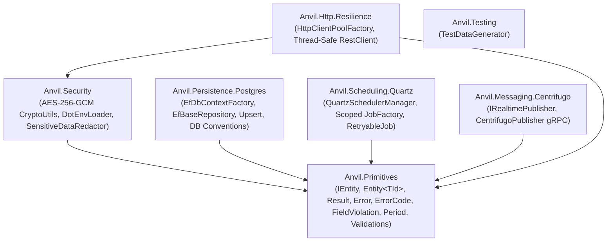

# ⚒️ Anvil — High-Performance, Lock-Free Modular SDK for .NET 10

[](https://dotnet.microsoft.com/)
[](#automated-governance-and-architectural-fitness-functions)
[-brightgreen)](#automated-governance-and-architectural-fitness-functions)
[](LICENSE)

**Anvil** is an opinionated, modular, lock-free, and zero-cache backend foundation SDK for **.NET 10**. Built as a suite of 7 independent NuGet packages (`Anvil.*`), it provides battle-tested building blocks for functional error handling, PostgreSQL persistence, authenticated cryptography, pooled HTTP resilience, distributed job scheduling, and real-time gRPC messaging—without forcing intrusive framework ceremony onto your application architecture.

> *"With good architecture, even mediocre code works and survives; with bad architecture, even the best code in the world extracts a heavy price—at the worst possible moment."*

---

## Table of Contents

1. [Architectural Manifesto and Core Dogmas](#architectural-manifesto-and-core-dogmas)
2. [Package Topology and Dependency Graph](#package-topology-and-dependency-graph)
3. [Architectural Decision Records (ADRs) and Trade-Off Analysis](#architectural-decision-records-adrs-and-trade-off-analysis)
   - [ADR-001: Value-Type `Result<T>` and HTTP 200 Envelope vs. Exceptions](#adr-001-value-type-resultt-and-http-200-envelope-vs-exceptions-for-flow-control)
   - [ADR-002: Extensible `ErrorCode` Struct (`EventId` Pattern) vs. Closed `enum`](#adr-002-extensible-errorcode-struct-eventid-pattern-vs-closed-enum)
   - [ADR-003: Database-Managed Governance (`id`, `created`, `updated`) vs. ORM Interceptors](#adr-003-database-managed-governance-id-created-updated-vs-orm-interceptors)
   - [ADR-004: Lock-Free Concurrency vs. `lock` and `SemaphoreSlim`](#adr-004-lock-free-concurrency-vs-lock-and-semaphoreslim)
   - [ADR-005: Unopinionated Application Layer (Services vs. UseCases)](#adr-005-unopinionated-application-layer-services-vs-usecases)
   - [ADR-006: `AES-256-GCM` Authenticated Encryption vs. Legacy `AES-CBC`](#adr-006-aes-256-gcm-authenticated-encryption-vs-legacy-aes-cbc)
4. [Module-by-Module Reference and Usage Guide](#module-by-module-reference-and-usage-guide)
   - [1. `Anvil.Primitives`](#1-anvilprimitives)
   - [2. `Anvil.Persistence.Postgres`](#2-anvilpersistencepostgres)
   - [3. `Anvil.Security`](#3-anvilsecurity)
   - [4. `Anvil.Http.Resilience`](#4-anvilhttpresilience)
   - [5. `Anvil.Scheduling.Quartz`](#5-anvilschedulingquartz)
   - [6. `Anvil.Messaging.Centrifugo`](#6-anvilmessagingcentrifugo)
   - [7. `Anvil.Testing`](#7-anviltesting)
5. [Automated Governance and Architectural Fitness Functions](#automated-governance-and-architectural-fitness-functions)

---

## Architectural Manifesto and Core Dogmas

Anvil's design is anchored in canonical software engineering literature (*Software Architecture: The Hard Parts*, *Fundamentals of Software Architecture*, *Learning Domain-Driven Design*, and the *.NET Runtime Design Guidelines*):

1. **Zero Accidental Coupling:** Core primitives (`Anvil.Primitives`) have **zero external framework or ORM dependencies**. Your domain entities never reference Entity Framework Core, Npgsql, Quartz, or gRPC attributes.
2. **Lock-Free by Default:** Blocking synchronization primitives (`lock`, `Monitor`, `Mutex`, `SemaphoreSlim`) degrade .NET `ThreadPool` scalability and risk thread starvation. Anvil enforces lock-free concurrency via immutable `readonly record struct` types, atomic `ConcurrentDictionary<TKey, Lazy<TValue>>`, and per-request message isolation.
3. **Zero-Cache Discipline:** In-memory or distributed caches (`IMemoryCache`, Redis) are never used as crutches for unoptimized queries or mutable state. Anvil focuses on **performance at the source**: `AsNoTracking()` projections, `Span<char>` stack-allocated parsing, pooled `SocketsHttpHandler` connections, and native PostgreSQL `ON CONFLICT DO UPDATE` (`Upsert`).
4. **Database as the Single Source of Truth:** Application servers suffer from NTP clock drift and shouldn't dictate audit timestamps. PostgreSQL owns primary key generation (`id`) and row lifecycle auditing (`created`, `updated`).

---

## Package Topology and Dependency Graph

Every module is compiled and versioned as an independent NuGet package. Install only what each microservice or layer requires:



| NuGet Package | Layer | External Dependencies | Core Responsibility |
| :--- | :--- | :--- | :--- |
| **`Anvil.Primitives`** | `1. Core` | *None (Pure .NET 10)* | `IEntity`, `Entity<TId>`, `Result`, `Result<T>`, `Error`, `ErrorCode`, `FieldViolation`, `Period`, `DataAnnotationValidator`, and zero-allocation `Span<T>` Brazilian validators (`Cpf`, `Cnpj`, `Cep`). |
| **`Anvil.Security`** | `2. Infrastructure` | `Anvil.Primitives` | Authenticated encryption (`AES-256-GCM` with 600k PBKDF2 iterations & memory zeroing), `.env` loader, and log redaction. |
| **`Anvil.Persistence.Postgres`** | `2. Infrastructure` | `EF Core 10`, `Npgsql 10` | Lock-free `EfDbContextFactory`, `EfBaseRepository`, native PostgreSQL `ON CONFLICT DO UPDATE` (`Upsert`), UTC converters, and database-managed conventions. |
| **`Anvil.Scheduling.Quartz`** | `2. Infrastructure` | `Quartz 3.16`, `Npgsql` | PostgreSQL-backed `QuartzSchedulerManager`, DI-scoped `JobFactory`, and resilient `RetryableJob<TJob>`. |
| **`Anvil.Messaging.Centrifugo`** | `2. Infrastructure` | `Grpc.Net.Client`, `Protobuf` | Real-time pub/sub publisher over gRPC (`IRealtimePublisher`, `CentrifugoPublisher`). |
| **`Anvil.Http.Resilience`** | `2. Infrastructure` | `Anvil.Security` | Pooled `SocketsHttpHandler` factory (`HttpClientPoolFactory`) and thread-safe per-request `RestClient`. |
| **`Anvil.Testing`** | `3. Testing` | `Bogus` | Synthetic test data generation (`TestDataGenerator`) for valid CPFs, phone numbers, names, and emails. |

---

## Architectural Decision Records (ADRs) and Trade-Off Analysis

Every architectural choice involves trade-offs. Below are the engineering rationales behind Anvil's core designs.

### ADR-001: Value-Type `Result<T>` and HTTP 200 Envelope vs. Exceptions for Flow Control

* **Context:** Throwing and catching C# exceptions for expected business failures (validation errors, missing records, duplicate keys) incurs expensive stack-trace unwinding and heap allocations in the CLR. Furthermore, in internal microservice ecosystems, uniform JSON envelopes over HTTP 200 (or explicit mapping) require `Result<T>` to be seamlessly serializable and deserializable across service boundaries.
* **Decision:**
  - `Result`, `Result<TValue>`, `Error`, `ErrorCode`, and `FieldViolation` are implemented as immutable **`readonly record struct`** value types (zero heap allocation for wrapper instances).
  - `IsFailure` is decorated with `[JsonIgnore]` so serialized JSON payloads remain compact (`{ "isSuccess": false, "error": { ... } }`), while C# callers retain ergonomic `.IsFailure` guard clauses.
  - Both `Result` and `Result<TValue>` provide `[JsonConstructor]` support for full round-trip serialization via `System.Text.Json`.

| Approach | Pros | Cons / Trade-offs |
| :--- | :--- | :--- |
| **Exceptions for Business Flow** | Familiar syntax; automatic stack unwinding. | High CPU/GC overhead on failure paths; hides failure modes from method signatures (dishonest contracts). |
| **Class-based `Result<T>`** | Reference semantics; easy inheritance. | Allocates a new heap object on *every* method return, pressuring Gen0 GC under high throughput. |
| **Anvil `readonly record struct Result<T>`** | **Zero heap allocation**; explicit method contracts; native HTTP 200 JSON envelope round-trip. | Requires disciplined propagation across call chains; mitigated via `Result.Success(...)` / `Result.Failure(...)` ergonomics. |

---

### ADR-002: Extensible `ErrorCode` Struct (`EventId` Pattern) vs. Closed `enum`

* **Context:** A shared NuGet package cannot predict every domain-specific error code (`InsufficientBalance`, `ExpiredPolicy`, `CarrierUnavailable`) that downstream microservices will need. If `ErrorCode` were a C# `enum`, consumers could never extend it without modifying the SDK source code.
* **Decision:** Inspired by Microsoft's `Microsoft.Extensions.Logging.EventId`, [`ErrorCode`](Primitives/ErrorCode.cs) is a `readonly record struct ErrorCode(int Id, string Name)`.
  - Anvil ships universal HTTP/infrastructure error codes in range `0..599` (`InvalidArgument = 400`, `NotFound = 404`, `AlreadyExists = 409`, `DatabaseError = 501`, etc.).
  - Consumer applications define their own strongly-typed static catalog (e.g., `1000+`) using the exact same `ErrorCode` type.

| Approach | Pros | Cons / Trade-offs |
| :--- | :--- | :--- |
| **Closed `enum ErrorCode`** | Simple switch statements; 4-byte integer representation. | **Impossible to extend** in consumer projects; forces generic catch-all codes like `BusinessError`. |
| **Raw `string` or `int` Codes** | Infinite flexibility. | *Primitive Obsession*; typos at compile time; separates numeric ID from human-readable identifier. |
| **Anvil `ErrorCode(int Id, string Name)`** | **Open/Closed Principle (OCP)**: ships standard codes while allowing unlimited strongly-typed domain extensions (`1000+`) with zero boxing. | Carries both an `int` (4B) and a string reference (8B) on the stack (16B total)—negligible in 64-bit CLR. |

---

### ADR-003: Database-Managed Governance (`id`, `created`, `updated`) vs. ORM Interceptors

* **Context:** Most .NET codebases initialize entity properties in C# (`public DateTime Created { get; set; } = DateTime.UtcNow;`) or use EF Core `SaveChangesInterceptor` to set `Updated`. In distributed deployments (multiple Kubernetes pods, background workers, and direct SQL batches), container clocks drift and raw SQL operations (`Upsert`, bulk updates) bypass EF Core's ChangeTracker entirely.
* **Decision:**
  - [`Entity<TId>`](Primitives/Entity.cs) is a pure 1:1 structural representation of a database table (`Id`, `Created`, `Updated`) with `protected init` setters and **no default C# clock initialization**.
  - `ModelBuilderDatabaseConventions.ApplyDatabaseManagedConventions()` configures EF Core to treat `Id` as `ValueGenerated.OnAdd`, `Created` as `ValueGenerated.OnAdd` (`PropertySaveBehavior.Ignore`), and `Updated` as `ValueGenerated.OnAddOrUpdate` (`PropertySaveBehavior.Ignore`).
  - PostgreSQL manages timestamps via [`0.database_conventions.sql`](Persistence.Postgres/Data/SQL/0.database_conventions.sql):
    - Uses **`clock_timestamp()`** inside the `BEFORE UPDATE` trigger so updates within long-running transactions record the true wall-clock modification instant (unlike `CURRENT_TIMESTAMP`, which freezes at `BEGIN`).
    - Enforces `NEW.created := OLD.created;` inside the trigger so `created` is physically immutable even against rogue SQL updates.
    - Uses `WHEN (OLD.* IS DISTINCT FROM NEW.*)` so no-op updates or idempotent `Upsert` calls do not dirty `updated` or cause PostgreSQL MVCC tuple bloat.

| Approach | Pros | Cons / Trade-offs |
| :--- | :--- | :--- |
| **C# `= DateTime.UtcNow` / EF Interceptors** | Works with in-memory fakes without a real DB. | Vulnerable to pod clock skew; bypassed by `ON CONFLICT DO UPDATE` (`Upsert`) and raw SQL; leaks persistence lifecycle into C#. |
| **PostgreSQL Triggers with `CURRENT_TIMESTAMP`** | Centralized in the database. | `CURRENT_TIMESTAMP` freezes at `BEGIN`; an `INSERT` followed by an `UPDATE` 2 seconds later in the same transaction yields identical `created` and `updated` timestamps. |
| **Anvil DB-Managed (`clock_timestamp()` + `IS DISTINCT FROM`)** | **Single clock authority**; works across EF Core, `Upsert`, Dapper, and manual SQL; prevents MVCC bloat on no-op updates; `RETURNING *` hydrates C# entities automatically. | Requires running [`0.database_conventions.sql`](Persistence.Postgres/Data/SQL/0.database_conventions.sql) and attaching the trigger when provisioning tables. |

---

### ADR-004: Lock-Free Concurrency vs. `lock` and `SemaphoreSlim`

* **Context:** Shared infrastructure components (such as HTTP client pools and REST clients) are invoked concurrently by thousands of ASP.NET Core request threads.
  - Using `lock` around dictionary lookups blocks `ThreadPool` worker threads.
  - Mutating `HttpClient.DefaultRequestHeaders` per request introduces race conditions across concurrent requests sharing the same `HttpClient`.
* **Decision:**
  - [`HttpClientPoolFactory`](Http.Resilience/HttpClientPoolFactory.cs) uses `ConcurrentDictionary<string, Lazy<HttpClient>>` with `LazyThreadSafetyMode.ExecutionAndPublication` to guarantee lock-free, once-only instantiation per endpoint/proxy key, backed by `SocketsHttpHandler` (`PooledConnectionLifetime = 15 min`, `AutomaticDecompression = All`).
  - [`RestClient`](Http.Resilience/RestClient.cs) never mutates `HttpClient.DefaultRequestHeaders` or `HttpClient.Timeout` after initialization. Instead, per-request headers and timeouts (via `CancellationTokenSource.CreateLinkedTokenSource`) are scoped strictly to each `HttpRequestMessage`.

---

### ADR-005: Unopinionated Application Layer (Services vs. UseCases)

* **Context:** Forcing an `Anvil.Application` package with mandatory `ICommand<T>`, `IQuery<T>`, or MediatR interfaces creates architectural friction. Simple CRUD domains thrive with cohesive Application Services (`CustomerService`), whereas complex business workflows benefit from isolated Vertical Slice UseCases (`ApproveLoanUseCase`).
* **Decision:** Anvil deliberately omits an `Application` wrapper package. Consumers depend directly on `Anvil.Primitives` and are free to structure their application layer using **Services**, **UseCases**, or a hybrid of both.

---

### ADR-006: `AES-256-GCM` Authenticated Encryption vs. Legacy `AES-CBC`

* **Context:** Legacy encryption utilities often use `AES-CBC` with static IVs or low iteration counts, leaving ciphertexts vulnerable to padding oracle attacks and tampering.
* **Decision:** [`CryptoUtils`](Security/CryptoUtils.cs) implements **Authenticated Encryption with Associated Data (AEAD)** using `AesGcm`:
  - **600,000 iterations** of `PBKDF2-HMAC-SHA256` (OWASP 2024+ recommendation) with a cryptographically random 128-bit salt per encryption.
  - Cryptographically random 96-bit nonce (`12 bytes`) and 128-bit authentication tag (`16 bytes`) prepended to the payload (`[Salt (16B) | Nonce (12B) | Tag (16B) | Ciphertext]`).
  - Derived key bytes are wiped from RAM inside a `finally` block using `CryptographicOperations.ZeroMemory(key)` to prevent memory-dump key extraction.

---

## Module-by-Module Reference and Usage Guide

### 1. `Anvil.Primitives`

Zero-dependency core primitives for your Domain and Application layers.

#### Functional `Result<T>`, `Error`, and `FieldViolation`
```csharp
using Anvil.Primitives;

public Result<CustomerDto> CreateCustomer(CreateCustomerRequest request)
{
    // 1. Automatic DTO attribute validation ([Required], [Cpf], [Cnpj], [Cep], etc.)
    var validation = DataAnnotationValidator.Validate(request);
    if (validation.IsFailure)
    {
        return Result.Failure<CustomerDto>(validation.Error);
    }

    // 2. Manual single-field validation failure
    if (request.BirthDate > DateOnly.FromDateTime(DateTime.UtcNow))
    {
        return Result.Failure<CustomerDto>(
            Error.Validation(nameof(request.BirthDate), "Birth date cannot be in the future."));
    }

    // 3. Domain conflict / NotFound
    if (CustomerExists(request.Cpf))
    {
        return Result.Failure<CustomerDto>(
            Error.Conflict("Customer with this CPF is already registered."));
    }

    return Result.Success(new CustomerDto(Guid.NewGuid(), request.Name));
}
```

#### Extending `ErrorCode` in Consumer Projects
```csharp
using Anvil.Primitives;

public static class BillingErrorCodes
{
    public static readonly ErrorCode InsufficientFunds = new(1001, nameof(InsufficientFunds));
    public static readonly ErrorCode InvoiceAlreadyPaid = new(1002, nameof(InvoiceAlreadyPaid));
}

// Usage:
return Result.Failure(Error.Conflict("Invoice is already paid.", BillingErrorCodes.InvoiceAlreadyPaid));
```

#### Structural Entities (`Entity<TId>`)
Choose `Guid`, `int`, `long`, or any non-null key type per entity:
```csharp
using Anvil.Primitives;

// UUID Primary Key (Guid)
public sealed class Customer : Entity<Guid>
{
    public string Name { get; set; } = string.Empty;
    public string Document { get; set; } = string.Empty;
}

// Integer Primary Key (int)
public sealed class OrderStatus : Entity<int>
{
    public string Code { get; set; } = string.Empty;
}
```

#### Allocation-Free `Span<T>` Brazilian Validators (`Cpf`, `Cnpj`, `Cep`)
Can be used both as **DataAnnotation attributes** on DTOs and as **extension methods**:
```csharp
using System.ComponentModel.DataAnnotations;
using Anvil.Primitives.Extensions;
using Anvil.Primitives.Validations;

public sealed record CreateCustomerRequest(
    [property: Required] string Name,
    [property: Cpf(ErrorMessage = "Invalid CPF.")] string Cpf,
    [property: Cep(ErrorMessage = "Invalid CEP.")] string Cep);

// Or direct Span-based boolean check (zero string allocations):
bool isValid = "123.456.789-09".IsValidCpf();
```

---

### 2. `Anvil.Persistence.Postgres`

#### Step 1: Provision PostgreSQL Conventions
Run [`Persistence.Postgres/Data/SQL/0.database_conventions.sql`](Persistence.Postgres/Data/SQL/0.database_conventions.sql) once in your PostgreSQL database:

```sql
CREATE OR REPLACE FUNCTION public.fn_set_updated_timestamp()
RETURNS TRIGGER
LANGUAGE plpgsql
AS $$
BEGIN
    NEW.created := OLD.created;
    NEW.updated := clock_timestamp();
    RETURN NEW;
END;
$$;

CREATE OR REPLACE PROCEDURE public.sp_attach_updated_trigger(
    p_schema_name TEXT,
    p_table_name TEXT
)
LANGUAGE plpgsql
AS $$
DECLARE
    v_trigger_name TEXT := format('trg_%s_set_updated', p_table_name);
BEGIN
    EXECUTE format('DROP TRIGGER IF EXISTS %I ON %I.%I;', v_trigger_name, p_schema_name, p_table_name);
    EXECUTE format(
        'CREATE TRIGGER %I BEFORE UPDATE ON %I.%I FOR EACH ROW WHEN (OLD.* IS DISTINCT FROM NEW.*) EXECUTE FUNCTION public.fn_set_updated_timestamp();',
        v_trigger_name, p_schema_name, p_table_name
    );
END;
$$;
```

Attach the trigger to your tables:
```sql
CREATE TABLE public.customers (
    id UUID PRIMARY KEY DEFAULT gen_random_uuid(),
    document VARCHAR(14) NOT NULL UNIQUE,
    full_name VARCHAR(150) NOT NULL,
    created TIMESTAMPTZ NOT NULL DEFAULT CURRENT_TIMESTAMP,
    updated TIMESTAMPTZ NULL
);

CALL public.sp_attach_updated_trigger('public', 'customers');
```

#### Step 2: Configure EF Core `DbContext`
Call `modelBuilder.ApplyDatabaseManagedConventions()` in `OnModelCreating`:
```csharp
using Anvil.Persistence.Postgres.Extensions;
using Microsoft.EntityFrameworkCore;

public sealed class AppDbContext : DbContext
{
    public AppDbContext(DbContextOptions<AppDbContext> options)
        : base(options)
    {
    }

    protected override void OnModelCreating(ModelBuilder modelBuilder)
    {
        base.OnModelCreating(modelBuilder);
        modelBuilder.ApplyConfigurationsFromAssembly(typeof(AppDbContext).Assembly);
        modelBuilder.ApplyDatabaseManagedConventions();
    }
}
```

#### Step 3: Create Repositories with Native PostgreSQL `Upsert`
Inherit from [`EfBaseRepository<TContext, TEntity>`](Persistence.Postgres/EfBaseRepository.cs) to get `GetAsync`, `GetListAsync`, `AddAsync`, `UpdateAsync`, `DeleteAsync`, and atomic `UpsertAsync` (`INSERT INTO ... ON CONFLICT DO UPDATE ... RETURNING *`):

```csharp
using Anvil.Persistence.Postgres;
using Anvil.Primitives;

public sealed class CustomerRepository : EfBaseRepository<AppDbContext, Customer>
{
    public CustomerRepository(IEfDbContextFactory contextFactory)
        : base(contextFactory)
    {
    }

    public async Task<Result<Customer?>> UpsertByDocumentAsync(Customer customer)
    {
        // Automatically excludes database-managed columns (id, created, updated)
        // from INSERT/UPDATE and returns the hydrated entity via RETURNING *
        return await UpsertAsync(
            entity: customer,
            uniqueIndexSelectors: [x => x.Document],
            ignoreNullValues: true,
            returnEntity: true);
    }
}
```

---

### 3. `Anvil.Security`

```csharp
using Anvil.Security;

// 1. Load environment variables from .env at startup
DotEnvLoader.Load();

// 2. AES-256-GCM Encryption & Decryption
string cipherBase64 = CryptoUtils.EncryptToBase64("Sensitive-API-Secret", masterKey);
string plainText = CryptoUtils.DecryptFromBase64(cipherBase64, masterKey);

// 3. Redact sensitive keys from JSON/dictionary payloads before logging
string safeJson = SensitiveDataRedactor.RedactJson(rawJsonPayload);
```

---

### 4. `Anvil.Http.Resilience`

```csharp
using Anvil.Http.Resilience;

// Register in Program.cs:
builder.Services.AddAnvilHttpResilience();

// Inject IHttpClientPoolFactory or build a RestClient:
var restClient = new RestClient(
    baseUrl: "https://api.partner.com",
    httpClientFactory: httpClientPoolFactory,
    logger: logger);

var response = await restClient.GetAsync<PartnerResponse>(
    endpoint: "/v1/accounts",
    headers: new Dictionary<string, string> { ["X-Correlation-Id"] = correlationId },
    timeoutSeconds: 10);
```

---

### 5. `Anvil.Scheduling.Quartz`

1. Run the idempotent PostgreSQL schema script [`Scheduling.Quartz/Data/SQL/0.tables.sql`](Scheduling.Quartz/Data/SQL/0.tables.sql) in your database.
2. Register `builder.Services.AddAnvilQuartzScheduling();` in `Program.cs`.
3. Implement `IJob` or `IRetryableJob` (which automatically retries failed executions within a configurable time window before unscheduling).

---

### 6. `Anvil.Messaging.Centrifugo`

```csharp
using Anvil.Messaging.Centrifugo;

// Register in Program.cs:
builder.Services.AddAnvilCentrifugo(options =>
{
    options.ServerUrl = builder.Configuration["Centrifugo:ServerUrl"]!;
    options.ApiKey = builder.Configuration["Centrifugo:ApiKey"]!;
});

// Publish real-time events over gRPC:
await realtimePublisher.PublishAsync("orders#user-42", new { OrderId = id, Status = "Shipped" });
```

---

### 7. `Anvil.Testing`

```csharp
using Anvil.Testing;

string validCpf = TestDataGenerator.GenerateCpf();          // Passes Mod-11 CPF validation
string fullName = TestDataGenerator.GenerateName();         // Realistic Brazilian full name
string email    = TestDataGenerator.GenerateEmail(fullName);
string phone    = TestDataGenerator.GenerateCellPhone();
```

---

## Automated Governance and Architectural Fitness Functions

Anvil enforces its architectural invariants at compile time and in CI/CD via [`Directory.Build.props`](Directory.Build.props), [`.editorconfig`](.editorconfig), and [`ArchitectureTests`](ArchitectureTests/ArchitectureFitnessTests.cs):

- **Zero Warnings Policy (`<TreatWarningsAsErrors>true</TreatWarningsAsErrors>` & `<EnforceCodeStyleInBuild>true</EnforceCodeStyleInBuild>`):** Any analyzer violation breaks the build immediately.
- **JIT Devirtualization (`CA1852` & `CA1859` + `NetArchTest.Rules`):** All concrete infrastructure and service classes are enforced as `sealed` so the .NET 10 JIT compiler can devirtualize and inline method calls.
- **Explicit Structural Blocks (`IDE0011 = error`):** Mandatory `{ }` braces on all control flow statements (`if`, `else`, `for`, `foreach`, `while`)—eliminating `goto fail`-style bugs and merge conflict ambiguities.
- **Strict Layer Isolation (`NetArchTest.Rules`):** Automated tests verify that `Anvil.Primitives` never depends on infrastructure packages or ORMs.

